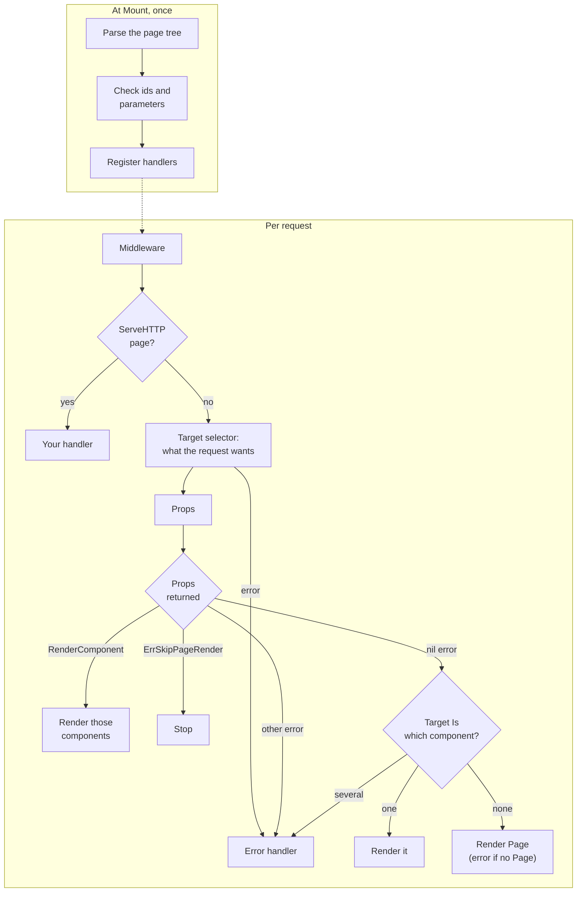

# How a Request Is Rendered

One sentence covers the whole model:

> **The request says what it wants. `Props` is the normal page flow; returning an error breaks it.**

- The **target selector** reads the request and produces a `RenderTarget`: *what the request wants*.
- **`Props`** loads data. Returning `(results…, nil)` continues the normal flow: the framework renders what the request wants, using those results. Returning an error breaks the flow. `RenderComponent`, `ErrSkipPageRender` and real errors are all errors.
- **The framework** renders the component the target `Is`, or `Page` if it `Is` none of them.

Everything on this page follows from those three steps.

## The flow



## Worked examples

### One page, many requests

A dashboard with a full `Page`, a main `Content` region and a `Notes` list inside it. Its `Props` also recognises two targets that aren't its own components: a standalone `ui.StatsWidget`, and a region of the report page that the dashboard reuses on purpose. The mount uses `HTMXv4RenderTarget`.

```gsx
component (p dashboard) Page(s Stats, notes []Note) {
    <Layout><main id={dashboard.Content |> id}><p.Content s={s} notes={notes} /></main></Layout>
}

component (p dashboard) Content(s Stats, notes []Note) {
    <ui.StatsWidget s={s} />
    <ul id={dashboard.Notes |> id}><p.Notes notes={notes} /></ul>
    <div id={report.Detail.Summary |> id}>…</div>
}

component (p dashboard) Notes(notes []Note) { … }
```

```go
func (p dashboard) Props(t structpages.RenderTarget, store *Store) (Stats, []Note, error) {
    switch {
    case t.Is(p.Notes): // one of this page's components: load just its data
        notes, err := store.Notes()
        return Stats{}, notes, err
    case t.Is(ui.StatsWidget): // a standalone component: render it yourself
        s, err := store.Stats()
        if err != nil {
            return Stats{}, nil, err
        }
        return Stats{}, nil, structpages.RenderComponent(ui.StatsWidget(s))
    case t.Is(report.Detail.Summary): // another page's region: render it yourself
        sum, err := store.Summary()
        if err != nil {
            return Stats{}, nil, err
        }
        return Stats{}, nil, structpages.RenderComponent(report.Detail{}.Summary(sum))
    }
    s, notes, err := store.All()
    return s, notes, err
}
```

| Request | The target `Is` | `Props` | Renders |
|---|---|---|---|
| Full page load | `Page` | loads everything | `Page(s, notes)` |
| Boosted link (`HX-Request-Type: full`) | `Page` | loads everything | `Page(s, notes)` |
| `HX-Target` = `Content`'s id | `Content` | asks nothing about `Content`, so it loads everything | `Content(s, notes)` |
| `HX-Target` = `Notes`' id | `Notes` | loads only the notes | `Notes(notes)` |
| `HX-Target` = `ui.StatsWidget`'s id | none of the page's components; `Is(ui.StatsWidget)` is true | `RenderComponent(ui.StatsWidget(s))` | the widget |
| `HX-Target` = `report.Detail.Summary`'s id | none of the page's components; `Is(report.Detail.Summary)` is true | `RenderComponent(…Summary(sum))` | the report's summary |
| `HX-Target` = an id that isn't one of this page's components, and `Props` doesn't recognise it | none | loads everything | `Page(s, notes)`: a whole document lands in that region (see [When the target belongs to another page](#when-the-target-belongs-to-another-page)) |

Things to notice:

- **`Props` asks only when it wants to load less.** It never asks about `Content`, yet `Content` renders when it's targeted: the framework asks the target itself, after `Props`.
- **Each component takes its share of the results by type.** `Notes` takes only `[]Note`, so the `Stats{}` that `Props` returns for it is never used.
- **A target that isn't one of the page's components needs `RenderComponent`.** The framework can only render the page's own components; for a standalone function or another page's component, `Props` builds it.
- **`t.Is(p.Notes)` and `t.Is(dashboard.Notes)` are the same question.** A bound method value and a method expression name the same component. One exception: inside a generic page type's own methods, Go compiles method values and expressions to anonymous closures, so `Is` can't identify them there. Selection is unaffected, since the framework asks with its own references.

### When the target belongs to another page

The last row of the table is the one to watch. It happens in two ways, and they have different fixes.

**1. A link inside another page's region navigates here.** Page A has a region with `hx-target:inherited`, and a boosted link inside it goes to the dashboard. The request arrives with `HX-Target` set to A's region. The user meant to navigate, so the right content is the dashboard's `Page`, but htmx will put it into A's region. No `Props` can fix that: the dashboard never had A's region.

- **Fix the markup:** a navigation link must not inherit a region's target. Put `hx-target:inherited` on the region's own controls (tabs, filters, pagination), not on a container that also holds navigation links, or give the link `hx-target="body"`.

**2. The page reuses another page's region id.** The dashboard renders a region with `report.Detail.Summary`'s id, and a reload inside it targets that id. The page does own this region in practice; it borrowed the id.

- **Fix the page:** give the region the page's own id (`id={p.Summary |> id}`), so it's one of the page's components and the normal flow renders it with no `Is` at all.
- **Or, when the reuse is deliberate,** recognise it in `Props` with `t.Is(report.Detail.Summary)` and return `RenderComponent`, as the example above does.

#### Catching it: decide from the response

Neither case is an error, so the error handler never sees them. And the request alone can't tell them apart from correct ones:

- A region's own controls may address it by a selector, such as `hx-target:inherited="closest tbody"`. That target names none of the page's components, and the page correctly answers with a `<tbody>` fragment.
- A page's `Props` may handle a borrowed id on purpose with `t.Is(Other.Region)`.
- An action handler may answer with another page's region after a write: a form posts to it with `hx-target={PermitPage.Fields |> target}`, and it returns `RenderComponent(…Fields(…))`.

A middleware that judges by the target, before `Props` runs, either misses the bug or breaks these. What every misplaced response has in common is visible only in the response: **a whole document answers a request for a region.** Check for that, in three places.

**When writing: the linter.** The [`region` check](./lint.md) flags case 2 for ids it can see in the templates.

**In tests: mount with a guard.** Have the helper that mounts test trees add a middleware that fails the test when an htmx request whose target isn't `body` is answered with a whole document. `isDocument` is htmx 4's own test: with the first `<head>` removed, the first tag is `html` or `body`.

```go
// guardRegions fails t when an htmx request whose target isn't body is
// answered with a document htmx would swap into that target.
func guardRegions(t testing.TB) structpages.MiddlewareFunc {
    return func(next http.Handler, _ *structpages.PageNode) http.Handler {
        return http.HandlerFunc(func(w http.ResponseWriter, r *http.Request) {
            target := r.Header.Get("HX-Target")
            if r.Header.Get("HX-Request") != "true" || r.Header.Get("HX-Request-Type") == "full" ||
                target == "" || target == "body" {
                next.ServeHTTP(w, r)
                return
            }
            tw := &teeWriter{ResponseWriter: w}
            next.ServeHTTP(tw, r)
            if w.Header().Get("HX-Retarget") != "body" && isDocument(tw.body.String()) {
                t.Errorf("%s %s: a whole document answers an htmx request for %q", r.Method, r.URL, target)
            }
        })
    }
}

var (
    firstHead = regexp.MustCompile(`(?i)<head(\s[^>]*)?>[\s\S]*?</head>`)
    firstTag  = regexp.MustCompile(`(?i)<([a-z][^/>\x20\t\r\n\f]*)`)
)

func isDocument(body string) bool {
    if loc := firstHead.FindStringIndex(body); loc != nil {
        body = body[:loc[0]] + body[loc[1]:]
    }
    m := firstTag.FindStringSubmatch(body)
    return m != nil && (strings.EqualFold(m[1], "html") || strings.EqualFold(m[1], "body"))
}

type teeWriter struct {
    http.ResponseWriter
    body bytes.Buffer
}

func (w *teeWriter) Write(p []byte) (int, error) {
    w.body.Write(p)
    return w.ResponseWriter.Write(p)
}

func (w *teeWriter) Unwrap() http.ResponseWriter { return w.ResponseWriter }
```

Then send each region's own requests in tests: its reload, its tabs, its pagination.

**In the browser: a listener.** htmx 4 fires `htmx:after:request` after it reads the response and before it applies `HX-Retarget`/`HX-Reswap`, so a listener can see a document bound for a region and send it to `body` instead. That covers case 1, a link that inherited a region's target, as well as any case 2 the linter and tests missed. Logging with `console.error` makes browser tests fail on it:

```js
// isDocument is htmx 4's test for a response it parses as a whole document.
function isDocument(text) {
  const rest = text.replace(/<head(\s[^>]*)?>[\s\S]*?<\/head>/i, "");
  const tag = rest.match(/<([a-z][^\/>\x20\t\r\n\f]*)/i)?.[1]?.toLowerCase();
  return tag === "html" || tag === "body";
}

document.addEventListener("htmx:after:request", (evt) => {
  const ctx = evt.detail?.ctx;
  if (!ctx || ctx.select || !isDocument(ctx.text ?? "")) return;
  if ((ctx.hx?.reswap ?? ctx.swap ?? "").split(" ")[0] === "none") return;
  const retarget = ctx.hx?.retarget;
  if (retarget ? retarget === "body" : ctx.target === document.body) return;
  console.error("htmx: a whole document answered a request for a region", ctx.request?.action);
  ctx.hx ||= {};
  ctx.hx.retarget = "body";
  ctx.hx.reswap = "innerMorph";
});
```

Requests with `hx-select` are skipped, since they pick a fragment out of the document on purpose. For htmx 2, the same check fits in `htmx:beforeSwap`, setting `evt.detail.target` to `document.body`.

### Recognised, but not rendered

```go
func (p dashboard) Props(t structpages.RenderTarget, store *Store) (Stats, []Note, error) {
    if t.Is(ui.StatsWidget) {
        s, err := store.Stats()
        return s, nil, err // no error: normal flow
    }
    …
}
```

A request for the widget renders `Page`, not the widget. Asking `Is` changes nothing: after `Props`, the framework asks the target about the page's own components, the widget is none of them, so `Page` renders. Return `RenderComponent(ui.StatsWidget(s))` to render it.

### A page without `Page`

```gsx
type exportPage struct{}

func (p exportPage) Props(r *http.Request, store *Store) (Rows, error) {
    rows, err := store.Rows(r.Context())
    if err != nil {
        return nil, err
    }
    if r.URL.Query().Get("view") == "table" {
        return nil, structpages.RenderComponent(p.Table(rows))
    }
    return rows, nil // wants Card? renders Card. Wants nothing? error.
}

component (p exportPage) Table(rows Rows) { … }
component (p exportPage) Card(rows Rows) { … }
```

When the request wants none of its components, a page without `Page` has nothing to fall back to: returning no error is an error (`page <name> has no Page component…`). `Props` must choose with `RenderComponent`.

### A custom selector

```go
// queryTarget: ?partial=<id> wants the component with that generated id.
type queryTarget struct {
    r  *http.Request
    id string
}

func (q queryTarget) Is(component any) bool {
    id, err := structpages.ID(q.r.Context(), component)
    return err == nil && id == q.id
}

structpages.WithTargetSelector(func(r *http.Request, _ *structpages.PageNode) (structpages.RenderTarget, error) {
    return queryTarget{r: r, id: r.URL.Query().Get("partial")}, nil
})
```

The framework only ever calls `Is`, so a custom target takes part exactly like the htmx ones: `?partial=<Notes' id>` renders `Notes`, and no parameter renders `Page`. Building `Is` on `structpages.ID` keeps the `ID`/`Is` symmetry. `Is` must answer for one component at most: a target that `Is` two of the page's components is an error naming them, never a guess.

## What the request wants: the target selector

`WithTargetSelector` sets how every request of the mount is read. **There is no default htmx behaviour**: without a selector, every request wants `Page`, and `Props` decides anything else.

| Option | Reads | The target `Is` |
|---|---|---|
| none | nothing | the page's `Page` |
| `WithTargetSelector(HTMXRenderTarget)` | htmx 1/2: `HX-Request`, `HX-Target` (a bare id) | the page's component that `HX-Target` names (its generated id, or its name or a suffix of it; see the [API guide](./api.md#htmxrendertarget)); `Page` when it isn't an htmx request or has no `HX-Target` |
| `WithTargetSelector(HTMXv4RenderTarget)` | htmx 4: also `HX-Request-Type`, with `HX-Target` as `tag#id` | the same, and `Page` for `HX-Request-Type: full` (boosted links, `hx-select`) |
| `WithTargetSelector(yourFunc)` | anything | whatever your `RenderTarget`'s `Is` answers |

```go
sp, err := structpages.Mount(mux, pages{}, "/", "App",
    structpages.WithTargetSelector(structpages.HTMXv4RenderTarget),
)
```

When an htmx request's `HX-Target` matches none of the served page's components, the target `Is` none of them. It can still be asked about other things the id might belong to: a standalone function component, or another page's component (see [Regions shared across pages](#regions-shared-across-pages)).

## `Props`: the normal flow, or a break

`Props` receives the target like any other parameter and decides:

| `Props` returns | What happens |
|---|---|
| `(results…, nil)` | **Normal flow.** The component the target `Is` renders with `results`, otherwise `Page`. |
| `RenderComponent(c, more…)` | **Break:** render `c` and then `more`, in order, as one response. |
| `ErrSkipPageRender` | **Break:** `Props` has already responded, for example with a redirect. |
| any other error | **Break:** the [error handler](./error-handling.md) renders it. |

A page without `Props` takes the normal flow every time.

### Load only what the request wants

`Props` can ask the target before loading anything. `Is` is a plain question with no side effects:

```go
func (p dashboard) Props(t structpages.RenderTarget, s *Store) (Stats, []Note, error) {
    if t.Is(p.Notes) {
        notes, err := s.Notes()
        return Stats{}, notes, err // the framework renders Notes
    }
    stats, err := s.Stats()
    if err != nil {
        return Stats{}, nil, err
    }
    notes, err := s.Notes()
    return stats, notes, err // the framework renders Page
}
```

### Components take what they need by type

A component's parameters are filled by type from `Props`' results, so one `Props` can serve several components, each declaring only its share:

```gsx
component (p dashboard) Page(s Stats, notes []Note) { … }
component (p dashboard) Notes(notes []Note) { … }   // HX-Target: Notes' id
component (p dashboard) Summary(s Stats) { … }      // HX-Target: Summary's id
```

Each result fills at most one parameter. Return zero values for what the request doesn't want.

### Breaking the flow on purpose

When the request wants one thing and you need to render another, return `RenderComponent`. It isn't a special case for standalone functions: it's how `Props` overrides the normal flow, for any reason.

```go
func (p dashboard) Props(t structpages.RenderTarget, s *Store) (Stats, []Note, error) {
    if t.Is(p.Notes) {
        notes, err := s.Notes()
        if err != nil {
            // The request wanted Notes; render an inline notice instead.
            return Stats{}, nil, structpages.RenderComponent(p.NotesUnavailable(err))
        }
        return Stats{}, notes, nil
    }
    …
}
```

- **Render a different component:** `RenderComponent(p.NotesUnavailable(err))`, `RenderComponent(p.Page(stats, nil))`, or any component from another package. Components are built at the call site, so their arguments are type-checked.
- **Set a status as well:** set the `Content-Type` and call `w.WriteHeader(...)` before returning `RenderComponent(...)`. The status goes out first, so the framework can't set the header after it. With htmx 2, error statuses aren't swapped unless its `responseHandling` config says so.
- **Treat it as a failure:** return the error, and the error handler renders it.

## Updating several regions

`RenderComponent` takes several components and renders them in order as one response. With htmx, that means updating several regions at once.

**htmx 4.** Wrap each extra region in `<hx-partial>`, with its target generated by the `target` filter. In a `.gsx` file, element literals work directly in `Props`:

```gsx
func (p dashboard) Props(r *http.Request, s *Store) (Stats, []Note, error) {
    if r.Method == http.MethodPost {
        notes, err := s.AddNote(r.FormValue("text"))
        if err != nil {
            return Stats{}, nil, err
        }
        return Stats{}, nil, structpages.RenderComponent(
            p.Notes(notes),
            <hx-partial hx-target={p.NoteCount |> target} hx-swap="innerHTML">
                <p.NoteCount n={len(notes)} />
            </hx-partial>,
        )
    }
    …
}
```

The first component is the main swap into the request's own target. Each `<hx-partial>` is swapped into its own target. A response made only of partials skips the main swap.

**`.go` files** can't use element literals, so put the wrapper in a component and pass the components:

```go
return Stats{}, nil, structpages.RenderComponent(p.Notes(notes), p.NoteCountPartial(len(notes)))
```

**htmx 2.** Out-of-band swaps are marked on the component's root element instead: `<span id={p.NoteCount |> id} hx-swap-oob="true">`.

**`ServeHTTP` handlers** can render several components to the writer one after the other.

## Regions shared across pages

The rule that ties ids to targets:

> **An element rendered with id `ID(ctx, X)` produces a request whose target `Is(X)`.**

That holds for the served page's own components, for standalone functions, and for **other pages' components**. So when a page's markup reuses another page's region, its `Props` can recognise that region and decide what to render:

```go
func (p aceSection) Props(t structpages.RenderTarget, s *Store) (aceProps, error) {
    if t.Is(report.DetailPage.Content) { // a region this page shares on purpose
        return aceProps{}, structpages.RenderComponent(p.Region(load(s)))
    }
    …
}
```

Another page's component matches only by its exact generated id, the one `ID` and the `id` filter produce. If `Props` doesn't act on it, the normal flow applies, and `Page` renders.

::: warning A whole document in a region
When an htmx request targets a region the served page doesn't have, and `Props` doesn't decide, `Page` renders. That's the normal flow, but if `Page` is a whole document, htmx swaps it *inside* the region. [When the target belongs to another page](#when-the-target-belongs-to-another-page) covers the two ways this happens and how to fix and catch each.
:::

## Where parameter values come from

`Props`, extended `ServeHTTP` and component methods are all filled by type, from these sources in order:

1. **`Props`' results** (for components only), each used at most once.
2. **Per-request values:** `http.ResponseWriter`, `*http.Request`, `RenderTarget`, `*PageNode`. A component gets the writer, request and target only for a parameter of exactly those types.
3. **Request args:** the page's own `RequestArgs`, then each ancestor's, then `WithRequestArgs`. Each runs at most once per request.
4. **`WithArgs` values**, registered once at `Mount`.

Within the first two sources, a value of exactly the parameter's type wins, then the first value assignable to it, in the order listed. An interface parameter that two request args (at one level) or two `WithArgs` values implement fails `Mount`. A parameter nothing fills fails the request that needs it. See [Dependency Injection](./dependency-injection.md) for the matching rules and request args.

## Migrating from v0.8

- **htmx apps must choose a selector.** Add `structpages.WithTargetSelector(structpages.HTMXRenderTarget)` for htmx 1/2, or `HTMXv4RenderTarget` for htmx 4, to `Mount`. Without it, partial requests render the full `Page`, and nothing reports an error. The linter's `selector` check flags a `Mount` without one when its pages' templates use htmx.
- **"Targeted but not handled" is gone.** If `Props` recognises a target with `Is` and then returns no error, that's the normal flow: `Page` renders. Return `RenderComponent` to render what you recognised.
- **Component parameters are checked at `Mount`,** like `Props`' parameters, including helper components that requests never select. An interface parameter that two `WithArgs` values implement now fails `Mount`; declare the concrete type, narrow the interface, or register a pointer to an interface variable.
- **Components can take per-request values and request args** as well as `Props`' results. They get the writer, request and target only for parameters of exactly those types, so an existing `io.Writer` or `any` parameter is still filled as before.
